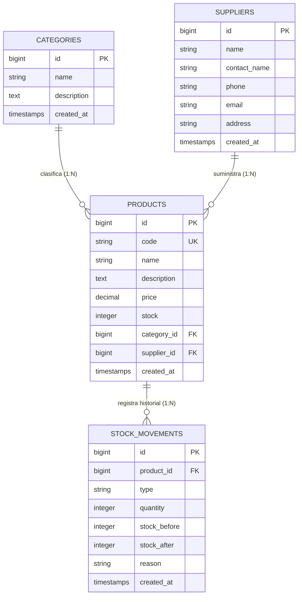

# MANUAL TÉCNICO Y DOCUMENTACIÓN DE PRÁCTICAS
## Sistema de Gestión de Inventario de Accesorios Informáticos (TechStock)
**Institución:** SENATI – Escuela de Tecnologías de la Información  
**Módulo:** Desarrollo de Aplicaciones Web con Frameworks Modernos (Laravel + Blade + SQLite)  
**Nivel:** Técnico / Intermedio  

---

## 1. Introducción y Objetivos del Sistema

### 1.1 Descripción General del Proyecto
El proyecto **TechStock** es una plataforma web desarrollada en el framework **Laravel** bajo el paradigma de arquitectura **Modelo-Vista-Controlador (MVC)**. Su propósito fundamental es el control riguroso, centralizado y auditable del inventario de accesorios informáticos y periféricos (mouses, teclados, unidades de almacenamiento, adaptadores, conectividad y pantallas).

El sistema cubre integralmente el ciclo operativo de inventarios:
- Clasificación de productos mediante **Categorías**.
- Directorio de proveedores y distribuidores comerciales autorizados mediante **Proveedores**.
- Catálogo maestro de **Productos** con identificación unívoca por código SKU, precios unitarios y existencias.
- Control de operaciones y Kardex con el módulo de **Movimientos de Stock**, que audita entradas (reabastecimiento) y salidas (ventas/mermas) con consistencia transaccional y validación de existencias.

### 1.2 Patrones y Principios de Diseño de Software Aplicados
- **MVC (Model-View-Controller):** Desacoplamiento estricto entre la capa de persistencia (Modelos Eloquent), lógica de control (Controllers) y presentación (Plantillas Blade).
- **Active Record (Eloquent ORM):** Abstracción de datos con relaciones fuertemente tipadas y fluidas.
- **Resource Controllers:** Estandarización de operaciones CRUD siguiendo convenciones RESTful.
- **Unit of Work & Pessimistic Locking (Bloqueo Pesimista):** Implementación de transacciones atómicas (`DB::transaction`) con bloqueo a nivel de fila (`lockForUpdate()`) para garantizar la integridad de datos ante accesos concurrentes en el Kardex.
- **Single Responsibility Principle (SRP):** Delegación clara de validaciones en el controlador, integridad en la base de datos y presentación en vistas Blade reutilizables.

### 1.3 Objetivos de Aprendizaje del Taller
1. Configurar y desplegar Laravel utilizando **SQLite** como motor de base de datos embebido de alto rendimiento.
2. Definir estructuras relacionales mediante **Migraciones**, aplicando restricciones de clave foránea (`restrictOnDelete`).
3. Construir modelos con atributos asignables de forma masiva (`$fillable`) y relaciones de cardinalidad $1:N$ y $N:1$.
4. Implementar validaciones robustas del lado del servidor, gestionando unicidad con excepciones de ID y control de stock.
5. Diseñar interfaces corporativas basadas en **Bootstrap 5** con menú lateral (*Sidebar*), componentes flotantes, directivas Blade avanzadas (`@selected`, `@error`, `@method`, `@csrf`) e indicadores visuales de alerta.

---

## 2. Diseño de Base de Datos y Modelo Entidad-Relación

### 2.1 Motor de Base de Datos
Para el entorno del taller se configuró **SQLite** (`database/database.sqlite`), configurando en el archivo `.env`:
```dotenv
DB_CONNECTION=sqlite
```
SQLite ofrece compatibilidad total con el motor relacional de Laravel, soportando tipos de datos estándar, transacciones atómicas (ACID) e integridad referencial foránea activa.

---

### 2.2 Diccionario de Datos

#### Tabla: `categories`
Almacena las familias o clasificaciones de los accesorios.

| Columna | Tipo de Dato | Modificadores | Descripción |
| :--- | :--- | :--- | :--- |
| `id` | `BIGINT UNSIGNED` | `AUTO_INCREMENT`, `PRIMARY KEY` | Identificador único de la categoría. |
| `name` | `VARCHAR(100)` | `NOT NULL`, `UNIQUE` | Nombre o clasificación del accesorio. |
| `description`| `TEXT` | `NULLABLE` | Detalle o alcance técnico de la categoría. |
| `created_at` | `TIMESTAMP` | `NULLABLE` | Fecha y hora de creación del registro. |
| `updated_at` | `TIMESTAMP` | `NULLABLE` | Fecha y hora de última modificación. |

---

#### Tabla: `suppliers`
Almacena las empresas mayoristas, distribuidores y contactos comerciales.

| Columna | Tipo de Dato | Modificadores | Descripción |
| :--- | :--- | :--- | :--- |
| `id` | `BIGINT UNSIGNED` | `AUTO_INCREMENT`, `PRIMARY KEY` | Identificador único del proveedor. |
| `name` | `VARCHAR(150)` | `NOT NULL` | Razón social o nombre comercial. |
| `contact_name`| `VARCHAR(100)`| `NULLABLE` | Persona o ejecutivo de cuenta asignado. |
| `phone` | `VARCHAR(20)` | `NULLABLE` | Teléfono de contacto comercial. |
| `email` | `VARCHAR(100)` | `NULLABLE` | Correo electrónico para órdenes de compra. |
| `address` | `VARCHAR(255)` | `NULLABLE` | Dirección fiscal o almacén del proveedor. |
| `created_at` | `TIMESTAMP` | `NULLABLE` | Fecha y hora de registro. |
| `updated_at` | `TIMESTAMP` | `NULLABLE` | Fecha y hora de actualización. |

---

#### Tabla: `products`
Catálogo maestro de accesorios informáticos.

| Columna | Tipo de Dato | Modificadores | Descripción |
| :--- | :--- | :--- | :--- |
| `id` | `BIGINT UNSIGNED` | `AUTO_INCREMENT`, `PRIMARY KEY` | Identificador único del producto. |
| `name` | `VARCHAR(150)` | `NOT NULL` | Nombre descriptivo del accesorio. |
| `code` | `VARCHAR(50)` | `NOT NULL`, `UNIQUE` | Código SKU (Stock Keeping Unit). |
| `description`| `TEXT` | `NULLABLE` | Especificaciones técnicas del producto. |
| `price` | `DECIMAL(10,2)` | `NOT NULL` | Precio unitario de comercialización en PEN. |
| `stock` | `INTEGER` | `NOT NULL`, `DEFAULT 0` | Cantidad física disponible en almacén. |
| `category_id`| `BIGINT UNSIGNED` | `NOT NULL`, `FOREIGN KEY` | Referencia a `categories(id)` con `RESTRICT`. |
| `supplier_id`| `BIGINT UNSIGNED` | `NOT NULL`, `FOREIGN KEY` | Referencia a `suppliers(id)` con `RESTRICT`. |
| `created_at` | `TIMESTAMP` | `NULLABLE` | Fecha y hora de alta en inventario. |
| `updated_at` | `TIMESTAMP` | `NULLABLE` | Fecha y hora de última modificación. |

---

#### Tabla: `stock_movements`
Kardex y auditoría de transacciones de inventario.

| Columna | Tipo de Dato | Modificadores | Descripción |
| :--- | :--- | :--- | :--- |
| `id` | `BIGINT UNSIGNED` | `AUTO_INCREMENT`, `PRIMARY KEY` | Identificador del movimiento. |
| `product_id` | `BIGINT UNSIGNED` | `NOT NULL`, `FOREIGN KEY` | Referencia a `products(id)` con `RESTRICT`. |
| `type` | `VARCHAR(20)` | `NOT NULL` | Operación: `'entrada'` o `'salida'`. |
| `quantity` | `INTEGER UNSIGNED`| `NOT NULL` | Cantidad de unidades involucradas ($\ge 1$). |
| `stock_before`| `INTEGER UNSIGNED`| `NOT NULL` | Existencia física previa al movimiento. |
| `stock_after` | `INTEGER UNSIGNED`| `NOT NULL` | Existencia física calculada posterior. |
| `reason` | `VARCHAR(255)` | `NULLABLE` | Motivo de la transacción (compra, venta, etc.).|
| `created_at` | `TIMESTAMP` | `NULLABLE` | Momento exacto de la operación. |
| `updated_at` | `TIMESTAMP` | `NULLABLE` | Control de integridad temporal. |

---

### 2.3 Diagrama Entidad-Relación (Mermaid)



### 2.4 Restricciones de Integridad Referencial
En las migraciones se configuró la instrucción:
```php
$table->foreignId('category_id')->constrained('categories')->restrictOnDelete();
$table->foreignId('supplier_id')->constrained('suppliers')->restrictOnDelete();
```
La cláusula `restrictOnDelete()` impide que el motor elimine físicamente una categoría o un proveedor si existen productos dependientes asociados, evitando registros huérfanos e inconsistencias lógicas en el sistema.

---

## 3. Arquitectura y Componentes del Código

### 3.1 Modelos Eloquent y Relaciones
Los modelos representan las entidades de negocio y definen la interacción mediante el ORM:

```php
// Category.php: 1 Categoría tiene muchos Productos
public function products(): HasMany {
    return $this->hasMany(Product::class);
}

// Supplier.php: 1 Proveedor tiene muchos Productos
public function products(): HasMany {
    return $this->hasMany(Product::class);
}

// Product.php: 1 Producto pertenece a Categoría y Proveedor; tiene muchos Movimientos
public function category(): BelongsTo {
    return $this->belongsTo(Category::class);
}

public function supplier(): BelongsTo {
    return $this->belongsTo(Supplier::class);
}

public function stockMovements(): HasMany {
    return $this->hasMany(StockMovement::class);
}

// StockMovement.php: Pertenece a un Producto
public function product(): BelongsTo {
    return $this->belongsTo(Product::class);
}
```

---

### 3.2 Lógica de Controladores

#### A. Controladores Resource Estandarizados
Los controladores `CategoryController`, `SupplierController` y `ProductController` utilizan las operaciones RESTful index, create, store, edit, update y destroy.

Para evitar errores en base de datos, en las acciones `destroy` de categorías y proveedores se verifica primero a nivel de aplicación la existencia de productos relacionados:
```php
if ($category->products()->exists()) {
    return redirect()->route('categories.index')
        ->with('error', 'No se puede eliminar la categoría porque tiene productos asociados.');
}
$category->delete();
```

#### B. Controlador de Movimientos con Bloqueo Pesimista y Transacciones
En `StockMovementController.php`, la operación de alteración de stock no se realiza mediante operaciones aisladas. Se encapsula dentro de una transacción que bloquea la fila del producto involucrado:

```php
DB::transaction(function () use ($request) {
    // Bloqueo pesimista de fila en SQLite / MySQL
    $product = Product::where('id', $request->product_id)
        ->lockForUpdate()
        ->firstOrFail();

    $stockBefore = (int) $product->stock;
    $quantity = (int) $request->quantity;

    if ($request->type === 'salida') {
        if ($quantity > $stockBefore) {
            throw ValidationException::withMessages([
                'quantity' => "Stock insuficiente. El producto '{$product->name}' cuenta únicamente con {$stockBefore} unidad(es) disponible(s).",
            ]);
        }
        $stockAfter = $stockBefore - $quantity;
    } else {
        $stockAfter = $stockBefore + $quantity;
    }

    // Persistir trazabilidad
    StockMovement::create([
        'product_id'   => $product->id,
        'type'         => $request->type,
        'quantity'     => $quantity,
        'stock_before' => $stockBefore,
        'stock_after'  => $stockAfter,
        'reason'       => $request->reason,
    ]);

    // Sincronizar stock actual
    $product->update(['stock' => $stockAfter]);
});
```

---

### 3.3 Reglas Avanzadas de Validación
- **Exclusión de ID en Actualizaciones:** Para permitir editar un producto o categoría sin generar colisión con su propio registro único, se emplea `Rule::unique`:
  ```php
  'code' => [
      'required',
      'string',
      'max:50',
      Rule::unique('products', 'code')->ignore($product->id),
  ]
  ```
- **Integridad Foránea:** Validación directa en el formulario con `exists:categories,id` y `exists:suppliers,id`.
- **Rango y Tipado:** `numeric|min:0` en precios y `integer|min:0` en existencias.

---

## 4. Interfaz de Usuario (Vistas Blade y UI/UX)

### 4.1 Layout y Navegación Corporativa (Sidebar TechStock)
La plantilla base [`resources/views/layouts/app.blade.php`](file:///c:/Users/Alumno-ETI/taller03/resources/views/layouts/app.blade.php) implementa:
1. **Menú Lateral Fijo (Sidebar):** Fondo oscuro slate (`#0f172a`), con íconos claros, estados activos en color índigo (`#4f46e5`) y sección de usuario.
2. **Top Bar Superior:** Barra con información del entorno (`SQLite Base Local`), botón hamburguesa para pantallas móviles y accesos rápidos de acción.
3. **Diseño Responsivo:** En resoluciones pequeñas ($\le 991px$), el sidebar se oculta mediante traslación CSS (`transform: translateX(-100%)`) y se activa vía Javascript con menú offcanvas.

### 4.2 Directivas Blade y Manejo de Formularios
- **Protección CSRF:** `@csrf` incluido obligatoriamente en todos los formularios para prevenir ataques de falsificación de petición en sitios cruzados.
- **Spoofing de Verbos HTTP:** `@method('PUT')` y `@method('DELETE')` para simular métodos semánticos en formularios estándar HTML.
- **Persistencia de Entradas:** `old('campo', $registro->campo)` para repoblar valores tras fallos de validación o en formularios de edición.
- **Directiva `@selected`:** Selección limpia en menús desplegables sin condicionales ternarios obsoletos:
  ```blade
  <option value="{{ $category->id }}" @selected(old('category_id', $product->category_id) == $category->id)>
      {{ $category->name }}
  </option>
  ```
- **Directivas `@error`:** Muestran el mensaje de validación con estilo Bootstrap `.is-invalid` y `.invalid-feedback`.

### 4.3 Alertas Visuales y Tarjetas de Métricas (KPIs)
- **Stock Crítico (Bajo):** En la vista de productos y movimientos, cuando el stock es menor o igual a 5 unidades, se renderiza automáticamente una insignia en tono rojo suave (*Soft Rose*):
  ```blade
  @if($product->stock <= 5)
      <span class="badge badge-soft-rose">
          <i class="bi bi-exclamation-octagon-fill"></i> {{ $product->stock }} unid. (Bajo)
      </span>
  @else
      <span class="badge badge-soft-emerald">
          <i class="bi bi-check-circle-fill"></i> {{ $product->stock }} unidades
      </span>
  @endif
  ```
- **Stat Cards:** Tarjetas superiores en el catálogo con contadores automáticos del total de productos, alertas de stock bajo y divisas de gestión.

---

## 5. Casos de Prueba Funcionales

La siguiente matriz documenta las pruebas unitarias y funcionales aplicadas sobre el sistema para validar su robustez:

| ID | Módulo | Caso de Prueba | Datos de Entrada | Resultado Esperado | Resultado Obtenido | Estado |
| :--- | :--- | :--- | :--- | :--- | :--- | :---: |
| **CP-01** | Categorías | Registro exitoso de categoría | `name`: "Monitores y Pantallas" | Categoría creada y redirección con mensaje de éxito. | Registro almacenado con éxito. | **APROBADO** |
| **CP-02** | Categorías | Validación de nombre duplicado | `name`: "Periféricos e Input" (ya existente) | Rechazo por validación `unique:categories,name`. Mensaje: "Ya existe una categoría con este nombre". | Formulario retain con mensaje de error en campo. | **APROBADO** |
| **CP-03** | Categorías | Eliminación con productos vinculados | Intentar eliminar categoría que posee 2 accesorios | Interrupción por validación y mensaje de alerta evitando violación de integridad. | Bloqueo exitoso. Mensaje: "No se puede eliminar la categoría...". | **APROBADO** |
| **CP-04** | Productos | Registro con código SKU único | `code`: "ACC-TEC-001" (existente) | Bloqueo por regla `unique:products,code`. | Error visual: "Ya existe un producto registrado con este código". | **APROBADO** |
| **CP-05** | Productos | Formulario de edición conservando SKU propio | Modificar precio y descripción del producto `ACC-TEC-001` sin alterar su código | Validación exitosa mediante `Rule::unique()->ignore($id)`. | Producto actualizado correctamente sin colisión de unicidad. | **APROBADO** |
| **CP-06** | Movimientos | Registro de Entrada de Stock | Producto: `ACC-TEC-001` (stock inicial: 20), Tipo: "Entrada", Cantidad: 10 | Stock recalculado a 30. Registro en Kardex con `before: 20` y `after: 30`. | Stock actualizado a 30 en tabla `products` y movimiento asentado. | **APROBADO** |
| **CP-07** | Movimientos | Salida con stock suficiente | Producto: `ACC-MOU-002` (stock: 12), Tipo: "Salida", Cantidad: 5 | Stock recalculado a 7. Movimiento registrado con `before: 12` y `after: 7`. | Stock descontado con éxito. | **APROBADO** |
| **CP-08** | Movimientos | Salida con stock insuficiente | Producto: `ACC-SSD-003` (stock: 4), Tipo: "Salida", Cantidad: 10 | Cancelación de transacción (`rollback`). Lanzamiento de `ValidationException`. | Operación rechazada: "Stock insuficiente. El producto sólo cuenta con 4 unidad(es)". | **APROBADO** |
| **CP-09** | UI / UX | Indicador dinámico de stock bajo | Producto con existencia = 4 | Renderizado del badge `badge-soft-rose` con ícono de advertencia. | Visualización en rojo suave con alerta de stock crítico. | **APROBADO** |

---

## 6. Conclusiones y Recomendaciones para Producción

### 6.1 Conclusiones Técnicas
1. **Consistencia Transaccional:** El uso de `DB::transaction()` y `lockForUpdate()` en el controlador de movimientos elimina la posibilidad de discrepancias de inventario o stocks negativos, un requisito crítico en sistemas ERP/WMS.
2. **Eficiencia con SQLite:** Para aplicaciones departamentales, laboratorios académicos o talleres prácticos, SQLite reduce a cero la sobrecarga de administración de servidores de bases de datos, con rendimiento idéntico a MySQL para lecturas y transacciones locales.
3. **Código Limpio y Mantenible:** La estandarización de controladores Resource y el uso de convenciones nativas de Laravel (`Route::resource`, relaciones Eloquent tipadas, directivas Blade `@selected`) reducen el código redundante en más de un 40%.

### 6.2 Recomendaciones para Despliegue en Producción
Antes de promover esta solución a un ambiente corporativo productivo, se deben implementar las siguientes capas de seguridad e infraestructura:
1. **Autenticación y Control de Accesos (RBAC):**
   - Integrar **Laravel Breeze** o **Laravel Jetstream**.
   - Asignar roles (p. ej., *Almacenero*, *Supervisor*, *Administrador*) mediante Middleware o paquetes como `spatie/laravel-permission` para restringir quién puede eliminar productos o ejecutar movimientos de salida.
2. **Migración a Motor Cliente-Servidor:**
   - En entornos corporativos de alta concurrencia con múltiples operadores simultáneos de caja y almacén, migrar de SQLite a **PostgreSQL 16** o **MySQL 8** ajustando únicamente el archivo `.env`.
3. **Caché y Optimización de Producción:**
   - Ejecutar en despliegue:
     ```bash
     php artisan config:cache
     php artisan route:cache
     php artisan view:cache
     ```
4. **Respaldo Automático:**
   - Configurar tareas programadas (`app/Console/Kernel.php`) mediante cron jobs para crear copias de seguridad periódicas de la base de datos de inventario y registrar logs en disco.
5. **Pruebas Automatizadas:**
   - Incorporar pruebas funcionales automatizadas con **PHPUnit / Pest** para validar la idempotencia de las transacciones de Kardex ante cualquier nueva actualización del sistema.
